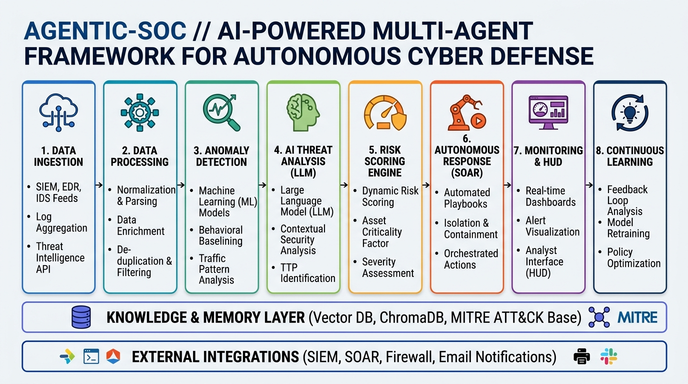

# 🛡️ AGENTIC-SOC // AI-POWERED MULTI-AGENT FRAMEWORK FOR AUTONOMOUS CYBER DEFENSE
> **Department of Computer Science & Engineering (Data Science) — Vemana Institute of Technology**  
> *8-Stage End-to-End Enterprise Architecture Specification*

---

## 🏛️ 1. Architecture Overview Diagram



```
[ Phase Tracker ]:  Detect  ➔  Analyze  ➔  Decide  ➔  Respond  ➔  Learn
```

---

## 🔄 2. Detailed Breakdown of the 8 Sequential Column Stages

### 1️⃣ DATA INGESTION
* **What Happens**: Collects security events and authentication telemetry from multiple enterprise sources in real-time.
* **Sources**:
  * **Authentication Logs**: Azure AD, Google Workspace, Okta, VPN logs.
  * **Network & Proxy Logs**: Firewall, Proxy, DNS egress traffic.
  * **Endpoint Telemetry**: EDR, Antivirus, Operating System Security Event Logs.
  * **Cloud & Application Logs**: AWS CloudTrail, Azure Monitor, SaaS Applications.
  * **Threat Feeds**: IP Reputation, IOCs, Malware Feeds.
  * **User Context**: Role, Geographic Location, Device Fingerprint, Access History.
* **Output**: Raw security events and unstructured context payloads.
* **AEGIS-SOC Implementation**: `tools/real_dataset_streamer.py` using $O(1)$ memory generator iteration reading Kaggle 31M-row RBA dataset (`my_dataset.csv/rba-dataset.csv`).

---

### 2️⃣ DATA PROCESSING & NORMALIZATION
* **What Happens**: Cleans, enriches, and normalizes raw telemetry into standardized JSON schemas.
* **Techniques**:
  * **Log Parsing**: Extracts structured fields (`user_principal_name`, `source_ip`, `geo`, `user_agent`, `session_token`).
  * **Deduplication**: Filters duplicate log entries within short sliding time windows.
  * **Time Normalization**: Standardizes timestamps into UTC ISO-8601 format.
  * **Data Enrichment**: Attaches IP Geolocation coordinates (`lat`, `lon`), ASN details, and user trajectory history (`user_last_events`).
  * **Noise Filtering**: Drops routine background system noise.
* **Output**: Structured, enriched security event JSON payloads (`TelemetryEvent`).
* **AEGIS-SOC Implementation**: `map_row_to_schema()` in `tools/real_dataset_streamer.py` & `server.py`.

---

### 3️⃣ ANOMALY & THREAT DETECTION
* **What Happens**: Identifies suspicious activities and potential threats using behavioral analytics and mathematical anomaly engines.
* **Detection Approaches**:
  * **Behavioral Analytics**: Compares active session behavior against user historical baselines.
  * **Statistical Anomaly Detection**: Calculates deviation from expected access patterns.
  * **Rule-Based Detection**: Evaluates MITRE ATT&CK technique indicators.
  * **Session & Token Anomaly**: Computes **Shannon Token Entropy ($H(X)$)** to detect stolen or synthetic cookie replays ($>3.85\text{ bits/char}$).
  * **Impossible Travel Detection**: Computes **Haversine Distance Velocity ($\text{km/h}$)** between consecutive login coordinates ($>800\text{ km/h}$).
* **Example Detections**:
  * 🪝 **AiTM Phishing Attempt**: Impossible travel jump across geographic locations (e.g. London to Tokyo in 5 mins).
  * 🔑 **Session Token Theft**: High entropy synthetic token replay.
  * 👤 **Unusual Login Behavior**: Access from untrusted anonymizer VPN proxies.
  * 🤖 **Account Takeover Attempt**: Automated brute-force scanner scripts (Hydra / Nmap / urllib).
* **Output**: Detected anomalies with severity scores.
* **AEGIS-SOC Implementation**: `core/math_engine.py` & Node 1 (`ingestion_node`) in `agents/graph_pipeline.py`.

---

### 4️⃣ AI-BASED THREAT ANALYSIS (LLM AGENT)
* **What Happens**: Leverages Large Language Models to understand threat context, correlate events, infer attacker intent, and validate threats.
* **Capabilities**:
  * **Contextual Reasoning**: Synthesizes natural language threat explanations.
  * **Narrative Generation**: Explains complex attack sequences for SOC analysts.
  * **Threat Explanation**: Details why an identity action breached security baselines.
  * **Attack Path Inference**: Identifies post-exploitation lateral movement risks.
  * **MITRE ATT&CK Mapping**: Maps anomalies to MITRE TTPs (T1539, T1550.004, T1110, T1090).
  * **Confidence Estimation**: Assigns qualitative threat confidence weights.
* **AI Models / Swarm Agents**: Google Gemini 2.5 Flash / Local LLM (Understands, reasons, and produces threat insights).
* **Output**: Natural language threat insights, attack classification, confidence & MITRE technique mapping.
* **AEGIS-SOC Implementation**: Node 2 (`analysis_node`) in `agents/graph_pipeline.py`.

---

### 5️⃣ RISK SCORING & DECISION ENGINE
* **What Happens**: Calculates a dynamic composite risk score and decides response actions based on impact and criticality.
* **Components**:
  * **Risk Scoring Model**: Dynamic score computation from **$0.0$ to $100.0$** with mathematical variance jitter ($\pm 2.5$).
  * **Asset Criticality**: Weights target identity and resource importance.
  * **User & Entity Risk**: Evaluates prior identity risk score history.
  * **Threat Confidence**: Factor in vector store similarity metrics.
* **Decision Outcomes**:
  * 🟢 **Monitor (Score $<50$)**: Safe corporate access. Logged in baseline ledger.
  * 🟡 **Investigate / HITL Review (Score $50-80$)**: Ambiguous anomaly. Pauses execution and routes to Human-In-The-Loop analyst portal.
  * 🔴 **Respond / Contain (Score $>80$)**: High-severity threat. Dispatches immediate autonomous SOAR block.
* **Output**: Response decision & action priority.
* **AEGIS-SOC Implementation**: Node 3 (`response_node`) in `agents/graph_pipeline.py` & `server.py`.

---

### 6️⃣ AUTONOMOUS RESPONSE (RESPONSE AGENT)
* **What Happens**: Automatically executes mitigation actions to contain and neutralize threats without human delay.
* **Response Actions**:
  * 🔑 **Revoke Session / Tokens**: Invalidates compromised OAuth access and refresh tokens.
  * 🔒 **Force MFA Re-authentication**: Demands multi-factor challenge on next login.
  * 🚫 **Block Malicious IP / User**: Adds attacker IP to perimeter firewall blocklists.
  * ⛔ **Disable Compromised Account**: Temporarily locks identity in Active Directory / Identity Provider.
  * 💻 **Isolate Endpoint**: Quarantines compromised host device from network.
  * 📧 **Send Alert / Ticket**: Dispatches real SMTP TLS warning emails to recipient inboxes and generates SOC tickets.
* **Output**: Mitigated threat and secured enterprise environment.
* **AEGIS-SOC Implementation**: `core/mitigation_engine.py` (`EnterpriseSOAREnforcer`).

---

### 7️⃣ MONITORING & VISUALIZATION
* **What Happens**: Provides real-time visibility, alerts, and dashboards for security analysts and SOC leadership.
* **Features**:
  * **Real-time Dashboards**: Sci-Fi Cyber Defense Command Theater HUD (`static/index.html`).
  * **Threat Timeline**: Chronological event logs in the immutable audit ledger.
  * **Alert Management**: Human-In-The-Loop (HITL) review modal for authorizing or dismissing flagged threats.
  * **Attack Path Visualization**: Central Lock Theater with real-time score displays and indicator badges.
  * **Reports & Audit Logs**: Full audit ledger export and PDF architecture docs (`PROJECT_ARCHITECTURE_AND_DATAFLOW.pdf`).
* **Output**: Real-time operational visibility and analyst insights.
* **AEGIS-SOC Implementation**: `static/index.html` Command Theater HUD.

---

### 8️⃣ LEARNING & CONTINUOUS IMPROVEMENT
* **What Happens**: Learns from incidents, analyst decisions, and feedback to improve future detection accuracy.
* **Methods**:
  * **Feedback Loop**: Incorporates analyst HITL approvals/dismissals into trajectory state.
  * **Model Fine-Tuning**: Updates prompt templates and vector embeddings.
  * **Threat Intelligence Update**: Seeds new MITRE ATT&CK technique vectors into ChromaDB.
  * **New Rule Generation**: Dynamically updates entropy and velocity detection thresholds.
  * **Knowledge Base Update**: Stores resolved incident playbooks in case repository.
* **Output**: Smarter detection and adaptive defense.
* **AEGIS-SOC Implementation**: `/api/v1/audit/approve-hitl` & `core/vector_store.py`.

---

## 🧠 3. Shared Knowledge & Memory Layer Across Agents

All 3 node agents (Ingestion, Analysis, Response) share access to a central **Knowledge & Memory Layer**:

1. **Vector Database (ChromaDB)**: Stores MITRE ATT&CK embeddings for fast semantic distance matching (`core/vector_store.py`).
2. **Threat Intelligence Repository**: Pre-indexed threat indicators, malicious IP reputation lists, and attack signatures.
3. **MITRE ATT&CK Knowledge Base**: Standardized TTP mapping (T1539, T1550.004, T1110, T1090).
4. **Semantic Memory (LLM Context Store)**: Remembers conversation history and agent reasoning outputs.
5. **Case & Incident Repository**: Historical audit ledger logs stored in `audit_ledger` (with 2,000-item sliding window memory cap).
6. **Playbooks & Response Templates**: Standardized SOAR mitigation playbooks.

---

## 🔌 4. External Integrations Layer

AEGIS-SOC integrates seamlessly with enterprise security tools:
* **SIEM**: Splunk / Microsoft Sentinel log forwarding (`tools/external_siem_injector.py`).
* **SOAR**: Palo Alto XSOAR / Custom Python SOAR (`core/mitigation_engine.py`).
* **Firewall**: Perimeter IP blocking APIs.
* **Identity Provider**: Azure AD / Okta OAuth session revocation.
* **Email / SMS Notifications**: Real SMTP TLS email dispatch (Port 587) for recipient alerts.

---

## 🎯 Summary Matrix: 8 Stages vs. AEGIS-SOC Code Modules

| Stage # | Stage Name | AEGIS-SOC Module / File | Mechanism |
| :---: | :--- | :--- | :--- |
| **1** | **Data Ingestion** | `tools/real_dataset_streamer.py` | $O(1)$ memory generator reading 31M Kaggle RBA CSV |
| **2** | **Data Normalization** | `server.py` | `TelemetryEvent` Pydantic JSON schema mapping |
| **3** | **Anomaly Detection** | `core/math_engine.py` | Shannon Entropy ($H(X)$) & Haversine Travel Velocity |
| **4** | **AI Threat Analysis** | `agents/graph_pipeline.py` | Google Gemini 2.5 Flash LLM + ChromaDB Vector RAG |
| **5** | **Risk Scoring Engine** | `agents/graph_pipeline.py` | Algorithmic score ($0-100$) + Triage Matrix |
| **6** | **Autonomous Response** | `core/mitigation_engine.py` | Session revocation, IP blocking & real SMTP email alert |
| **7** | **Monitoring & HUD** | `static/index.html` | Sci-Fi Command Theater HUD & Audit Ledger |
| **8** | **Continuous Learning** | `server.py` (`/approve-hitl`) | Analyst HITL decisions feedback loop |
