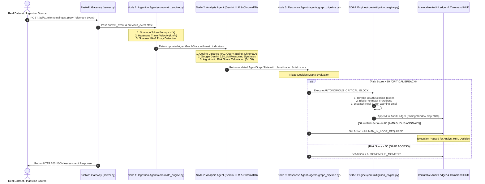

# 🛡️ AEGIS-SOC // METHODOLOGY DATA FLOW SPECIFICATION
> **Department of Computer Science & Engineering (Data Science) — Vemana Institute of Technology**  
> *Complete End-to-End Methodology Data Flow Specification for Autonomous Cyber Defense*

---

## 📐 1. End-to-End Methodology Data Flow Architecture



---

## 🔄 2. Detailed 8-Phase Methodology Data Flow Breakdown

```
 ┌──────────────────────────────────────────────────────────────────────────────────┐
 │                               METHODOLOGY DATA FLOW                              │
 └──────────────────────────────────────────────────────────────────────────────────┘
   [PHASE 1] DATA INGESTION & SCHEMA NORMALIZATION
       │  • Input: Raw CSV row from 31M Kaggle RBA Dataset or SIEM Injector.
       │  • Function: map_row_to_schema() extracts UPN, IP, Geo (lat,lon), Cookie, UA.
       │  • Output: Standardized TelemetryEvent JSON object.
       ▼
   [PHASE 2] MATHEMATICAL ANOMALY FEATURE EXTRACTION
       │  • Shannon Entropy H(X): Evaluates token character randomness (>3.85 bits/char).
       │  • Haversine Velocity: Calculates distance/time travel speed (>800 km/h).
       │  • Output: Quantitative anomaly indicators attached to AgentGraphState.
       ▼
   [PHASE 3] LANGGRAPH STATEFUL MULTI-AGENT SWARM (NODE 1 ➔ NODE 2 ➔ NODE 3)
       │  • Node 1 (Ingestion): Combines current event with user trajectory history.
       │  • Node 2 (Analysis): Passes math metrics to Vector Store & LLM.
       │  • Node 3 (Response): Evaluates triage rules & dispatches actions.
       ▼
   [PHASE 4] COGNITIVE AI & VECTOR RETRIEVAL (CHROMADB RAG + GEMINI 2.5 LLM)
       │  • ChromaDB Search: Retrieves MITRE ATT&CK embeddings (T1539, T1550.004, T1110, T1090).
       │  • Gemini 2.5 Flash: Generates natural language reasoning and explainable AI (XAI).
       │  • Output: MITRE technique code, semantic distance, and LLM reasoning text.
       ▼
   [PHASE 5] DECISION MATRIX & RISK SCORE TRIAGE
       │  • Computes Composite Risk Score (0.0 to 100.0) with dynamic variance.
       │  • Score > 80     ➔ AUTONOMOUS_CRITICAL_BLOCK
       │  • 50 ≤ Score ≤ 80 ➔ HUMAN_IN_LOOP_REQUIRED (HITL Pause)
       │  • Score < 50     ➔ AUTONOMOUS_MONITOR
       ▼
   [PHASE 6] AUTOMATED SOAR RESPONSE EXECUTION
       │  • Session Revocation: Invalidates stolen session cookie.
       │  • Firewall Block: Adds attacker IP to perimeter blocklist.
       │  • SMTP Email Alert: Sends HTML warning email via smtplib TLS (Port 587).
       ▼
   [PHASE 7] IMMUTABLE AUDIT LEDGER & COMMAND HUD VISUALIZATION
       │  • Audit Ledger: Prepend assessment to audit_ledger (max 2000 memory cap).
       │  • Sci-Fi HUD: Updates Lock Emblem, Target Radar Dot, and Audit Grid live.
       ▼
   [PHASE 8] HUMAN-IN-THE-LOOP (HITL) ANALYST FEEDBACK LOOP
          • Analyst reviews flagged events (Score 50-80) via HITL Modal.
          • Submits AUTHORIZE BLOCK or DISMISSED FALSE POSITIVE.
          • Feedback updates state store and triggers deferred SOAR routines.
```

---

## 🧪 3. Data Transformation Data Dictionary

| Phase | Input Data | Transformation Applied | Output Data | Responsible File |
| :--- | :--- | :--- | :--- | :--- |
| **Ingestion** | Raw CSV Log Row | `map_row_to_schema()` parsing | `TelemetryEvent` JSON | `tools/real_dataset_streamer.py` |
| **Feature Extraction** | `session_token`, `geo`, `timestamp` | Shannon Entropy & Haversine formula | `entropy_bits`, `velocity_kmh` | `core/math_engine.py` |
| **Vector RAG** | Anomaly text query | Cosine distance vector search | `mitre_id`, `distance`, `base_score` | `core/vector_store.py` |
| **Cognitive AI** | Telemetry + RAG match | Gemini 2.5 LLM prompt synthesis | `llm_reasoning` text | `agents/graph_pipeline.py` |
| **Risk Scoring** | Entropy, Velocity, RAG, UA | Composite weighted scoring | `risk_score` (0.0 - 100.0) | `agents/graph_pipeline.py` |
| **SOAR Enforce** | `risk_score > 80`, `source_ip`, `upn` | `smtplib` TLS + Session Revoke | `soar_execution_logs` list | `core/mitigation_engine.py` |
| **Audit & HUD** | `AgentAssessment` dict | Prepend to array + REST polling | HUD UI & Audit Ledger Grid | `server.py` & `static/index.html` |

---

## 🎯 Summary for Evaluation Presentations

When presenting this methodology data flow to your project evaluators:
1. **Highlight the Closed-Loop Flow**: Data enters via stream, passes through mathematical feature extraction, undergoes multi-agent swarm analysis, triggers automated SOAR containment, and updates the Command HUD in milliseconds.
2. **Emphasize Memory Safety**: The dataset streaming uses $O(1)$ generator memory ($\sim 35\text{ MB}$ RAM) and the audit ledger uses a 2,000-item sliding window cap, making the system enterprise-scalable.
