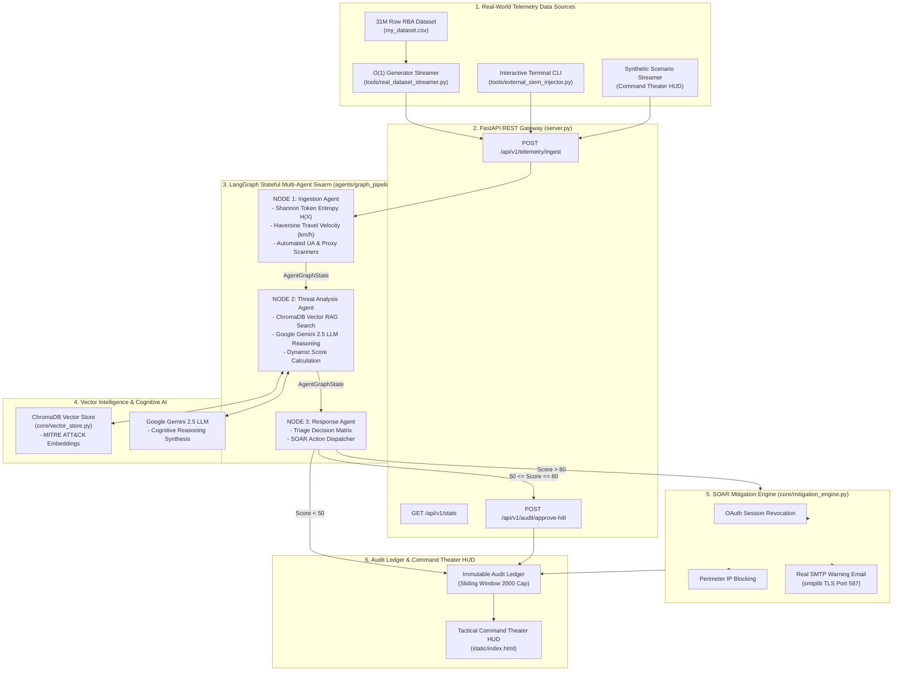

# 🛡️ AEGIS-SOC // System Architecture & Data Flow Guide
> **Enterprise Autonomous Cybersecurity Operations Center (Agentic-SOC)**  
> *Powered by LangGraph Multi-Agent Swarms, Google Gemini 2.5 Cognitive LLM, ChromaDB Vector RAG, and Real-Time SOAR Mitigation.*

---

## 📑 Executive Summary

**AEGIS-SOC** is an AI-driven, multi-agent autonomous security framework designed to detect, analyze, and mitigate advanced cyberattacks in real-time. By moving beyond traditional static firewall rules, AEGIS-SOC combines **mathematical anomaly engines** (Shannon Entropy & Haversine Travel Velocity) with **vector retrieval-augmented generation (RAG)** and **Google Gemini 2.5 LLM reasoning** to achieve explainable, low-latency incident response.

---

## 🏗️ 1. Complete System Architecture



---

## 🔄 2. End-to-End Telemetry Data Flow

```
[ Authentication Log Ingested ]
              │
              ▼
  [ 1. Ingestion Agent Node ]
      ├── Calculates Shannon Token Entropy H(X)
      ├── Computes Haversine Impossible Travel Velocity (km/h)
      └── Flags Automated User-Agents & VPN Proxies
              │
              ▼
  [ 2. Threat Analysis Agent Node ]
      ├── Queries ChromaDB for MITRE ATT&CK Technique Match
      ├── Invokes Google Gemini 2.5 LLM for Cognitive Reasoning
      └── Calculates Dynamic Algorithmic Risk Score (0-100)
              │
              ▼
  [ 3. Response Agent Node & Triage Matrix ]
      ├── Risk Score > 80  ➔ [ AUTONOMOUS CRITICAL BLOCK ] ➔ SOAR Mitigation Engine
      ├── 50 ≤ Score ≤ 80  ➔ [ HUMAN-IN-THE-LOOP (HITL) PAUSE ] ➔ Analyst Portal
      └── Risk Score < 50  ➔ [ AUTONOMOUS MONITOR ] ➔ Baseline Audit Ledger
              │
              ▼
  [ 4. SOAR Mitigation Execution ]
      ├── Revokes Compromised Identity Sessions
      ├── Blocks Attacker Perimeter IP Address
      └── Dispatches Real SMTP Warning Email to User Inbox
              │
              ▼
  [ 5. Live Command Theater HUD Display ]
```

---

## 🧱 3. Detailed Breakdown of Every Block & File

### 1. `server.py` — FastAPI REST Server & API Gateway
* **What it is**: The main entry point and web server for the entire SOC platform.
* **What it does**:
  * Exposes high-speed REST endpoints (`/api/v1/telemetry/ingest`, `/api/v1/audit/logs`, `/api/v1/stats`, `/api/v1/rag/query`).
  * Manages user trajectory state (`user_last_events`) to track consecutive user logins across geographical locations.
  * Enforces memory bounds on `audit_ledger` using a 2,000-item sliding window array cap.
  * Serves the static HTML/JS Command Theater HUD interface.

---

### 2. `agents/graph_pipeline.py` — LangGraph Stateful Multi-Agent Swarm
* **What it is**: The core multi-agent intelligence pipeline built on **LangGraph**.
* **How it works**:
  * **Node 1 (`ingestion_node`)**: Receives current telemetry and retrieves previous user login history. Computes **Haversine Distance Velocity** and **Shannon Token Entropy**.
  * **Node 2 (`analysis_node`)**: Queries the ChromaDB vector database for MITRE technique matches (T1539, T1550.004, T1110, T1090) and invokes **Google Gemini 2.5 Flash** for cognitive threat reasoning. Calculates dynamic risk scores ($0-100$) with variance jitter.
  * **Node 3 (`response_node`)**: Evaluates the triage matrix. Automatically dispatches SOAR enforcement for critical threats ($>80$), triggers HITL pauses for ambiguous threats ($50-80$), or logs safe baseline logins ($<50$).

---

### 3. `core/math_engine.py` — Mathematical Anomaly Detection Engine
* **What it is**: Mathematical feature extraction module.
* **How it works**:
  * **Shannon Entropy ($H(X)$)**:
    $$\text{Entropy } H(X) = -\sum_{i=1}^{n} P(x_i) \log_2 P(x_i)$$
    Measures character randomness in session tokens. Stolen or synthetic token replays yield high entropy ($>3.85\text{ bits/char}$).
  * **Haversine Travel Velocity**:
    Calculates great-circle distance between consecutive login coordinates:
    $$a = \sin^2\left(\frac{\Delta \phi}{2}\right) + \cos(\phi_1)\cos(\phi_2)\sin^2\left(\frac{\Delta \lambda}{2}\right)$$
    Dividing distance by time elapsed yields physical velocity in $\text{km/h}$. Physical travel speeds exceeding $800\text{ km/h}$ indicate **Impossible Travel (AiTM Phishing)**.

---

### 4. `core/vector_store.py` — ChromaDB Threat Intelligence Memory
* **What it is**: Vector database memory powering Retrieval-Augmented Generation (RAG).
* **How it works**:
  * Pre-seeds local **ChromaDB** with MITRE ATT&CK embeddings:
    * `T1539`: Adversary-in-the-Middle (AiTM) Phishing
    * `T1550.004`: Pass-the-Cookie / Token Theft
    * `T1110`: Brute Force / Account Takeover (ATO)
    * `T1090`: Anonymizing Proxy / Untrusted VPN Shift
  * Performs **Cosine Distance Semantic Queries** in milliseconds to match incoming attack descriptions against known threat vectors.

---

### 5. `core/mitigation_engine.py` — Enterprise SOAR Enforcer
* **What it is**: Automated Security Orchestration, Automation, and Response (SOAR) engine.
* **How it works**:
  * **`revoke_identity_session()`**: Invalidates compromised user session tokens and revokes OAuth access.
  * **`block_perimeter_ip()`**: Adds attacker IP addresses to perimeter firewall blocklists.
  * **`dispatch_security_notification_email()`**: Connects via Python `smtplib` TLS (Port 587) to send HTML warning emails to recipient inboxes when credentials exist in `.env`.

---

### 6. `tools/real_dataset_streamer.py` — 31-Million Row RBA Dataset Streamer
* **What it is**: High-performance dataset streamer for real-world cybersecurity data.
* **How it works**:
  * Uses Python `csv.DictReader` generator iterators to stream 1 GB+ CSV files (e.g. Kaggle 31-Million Row RBA Dataset `my_dataset.csv/rba-dataset.csv`) row-by-row with $O(1)$ RAM usage ($\sim 35\text{ MB}$ memory footprint).
  * Automatically resolves directory paths and maps schema columns dynamically.
  * Supports interactive speed modes ($50-150\text{ events/sec}$ vs real-time demo mode).

---

### 7. `static/index.html` — Sci-Fi Cyber Defense Command Theater UI
* **What it is**: Interactive executive HUD dashboard built with HTML5, Tailwind CSS, and JavaScript.
* **Features**:
  * **Central Lock Theater**: Displays real-time lock status (SYSTEM SECURE / HITL PAUSED / CRITICAL BREACH CONTAINED) with dynamic score readouts.
  * **Tactical World Map Radar**: Moves target marker over real geographical coordinates (`lat`, `lon`) for impossible travel visualization.
  * **Shannon Entropy Waveform Spectrum**: Visualizes real-time token randomness.
  * **Multi-Agent Swarm Inspector**: Shows internal node state dumps and ChromaDB RAG vector query simulator.
  * **Human-In-The-Loop (HITL) Portal**: Modal popup allowing security analysts to approve or dismiss ambiguous threats.

---

### 8. `test_system.py` — Automated Integration Test Suite
* **What it is**: Automated verification script testing all system subsystems.
* **Tests**:
  1. Shannon Entropy Calculation Test.
  2. Haversine Velocity Anomaly Test ($19,117\text{ km/h}$).
  3. ChromaDB Vector Store RAG Retrieval Test.
  4. Enterprise SOAR Engine & Email Dispatch Test.
  5. LangGraph Swarm Triage Matrix Test.
  6. Interactive HITL Analyst Approval Endpoint Test.

---

## 🎯 Summary of System Capabilities

| Capability | Module / Component | Mechanism |
| :--- | :--- | :--- |
| **Real-Time Data Streaming** | `tools/real_dataset_streamer.py` | $O(1)$ memory generator streaming over 31M row CSVs |
| **Impossible Travel Detection** | `core/math_engine.py` | Haversine distance formula ($>800\text{ km/h}$) |
| **Token Theft Detection** | `core/math_engine.py` | Shannon Entropy formula ($>3.85\text{ bits/char}$) |
| **Multi-Agent Orchestration** | `agents/graph_pipeline.py` | LangGraph 3-node stateful swarm (`AgentGraphState`) |
| **Cognitive Threat Analysis** | `agents/graph_pipeline.py` | Google Gemini 2.5 Flash LLM + ChromaDB RAG |
| **Automated Response** | `core/mitigation_engine.py` | Session revocation, IP blocking & real SMTP email alert |
| **Human-In-The-Loop Review** | `static/index.html` & `server.py` | Analyst review modal for scores between $50-80$ |
